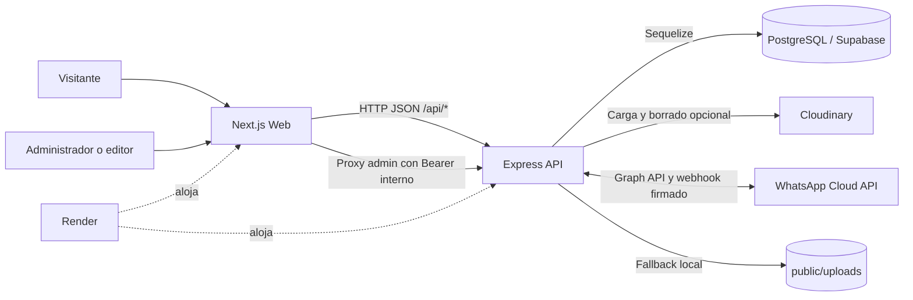
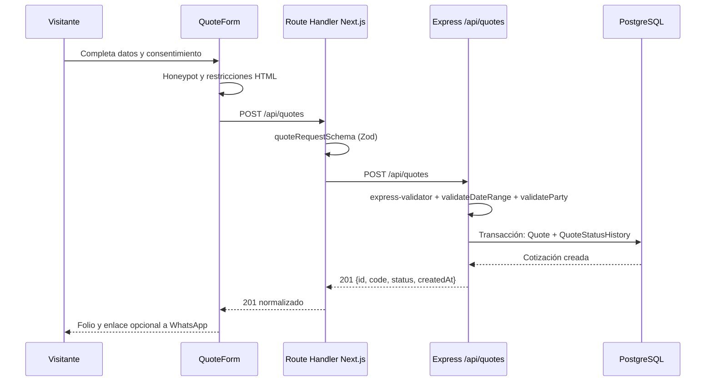
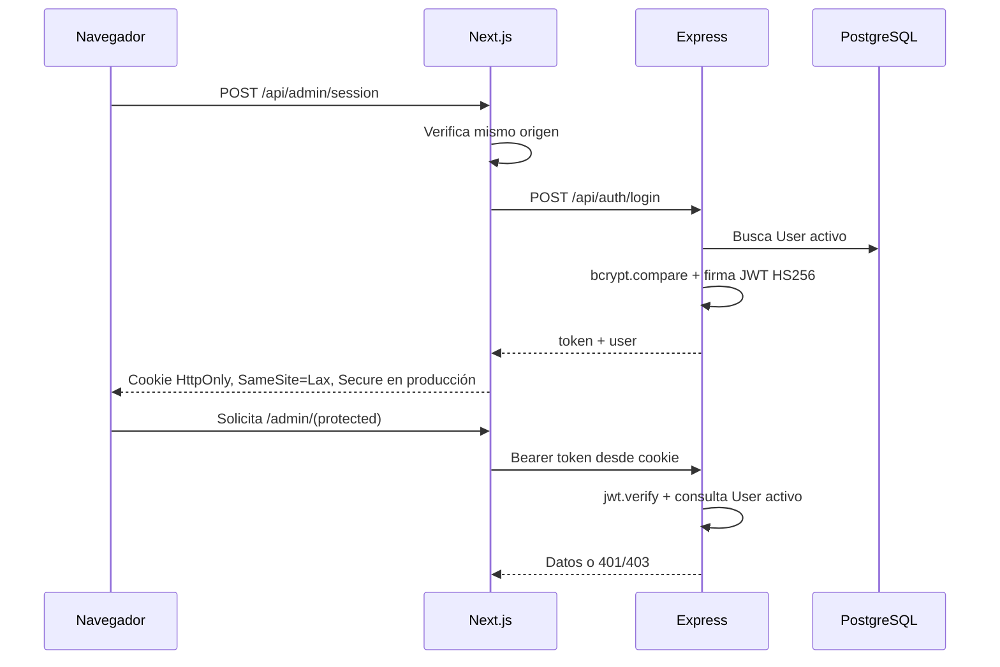
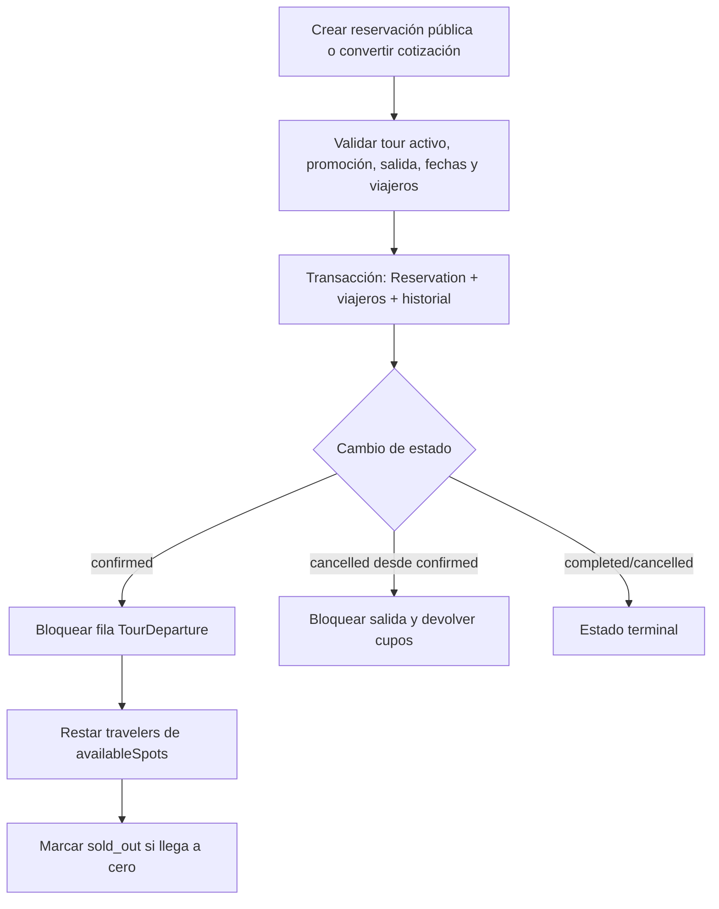

# Arquitectura

## Vista general

El sistema es un monorepositorio lógico con dos aplicaciones desplegables. El frontend funciona también como Backend for Frontend (BFF): los navegadores no reciben `API_BASE_URL` ni el JWT. Los Route Handlers de Next.js reenvían peticiones autorizadas al API Express.

## Componentes y responsabilidades

| Componente | Responsabilidad | Referencias |
| --- | --- | --- |
| App pública | Compone landing, catálogo, promociones y formulario. | `src/app/page.tsx`, `components/home`, `components/forms/QuoteForm.tsx` del frontend. |
| Panel | Protege páginas, consulta API y permite operaciones administrativas seleccionadas. | `src/app/admin`, `components/admin`. |
| BFF público | Valida cotización con Zod y normaliza errores antes de llamar al backend. | `src/app/api/quotes/route.ts`. |
| BFF admin | Gestiona cookie, lista blanca de rutas y proxy con `Authorization`. | `src/app/api/admin`. |
| API REST | Seguridad HTTP, validación, controladores y contrato JSON. | `src/app.js`, `src/routes/index.js`. |
| Dominio comercial | Cotizaciones, reservaciones, cupos, promociones, clientes y estados. | `src/modules/quotes`, `reservations`, `departures`, `promotions`, `customers`. |
| Persistencia | Modelos, relaciones, transacciones y migraciones. | `src/models`, `src/database`. |
| Integraciones | Cloudinary y WhatsApp. | `src/services/cloudinaryService.js`, `src/modules/whatsapp`. |

## Flujo público de cotización

El código de cotización usa `CG-AAAA-XXXXX`; una colisión se traduce en conflicto de restricción única y no se reintenta automáticamente.

## Autenticación y sesión administrativa

No existe refresh token ni tabla de sesiones. La desactivación del usuario invalida efectivamente el acceso en la siguiente solicitud porque `authenticate` consulta el usuario en BD. El logout borra la cookie, pero no revoca criptográficamente el JWT.

## Flujo de reservación y cupos

Las transiciones están declaradas en `src/utils/workflow.js`; `transitionReservation` usa bloqueo de fila para reducir carreras de disponibilidad.

## Persistencia y consistencia

- Sequelize usa `underscored` y timestamps.
- Las operaciones compuestas críticas usan transacciones: creación y transición de reservaciones, creación y estado de cotizaciones, imágenes primarias de promoción.
- Las asociaciones se definen centralmente en `src/models/index.js`.
- Las migraciones crean constraints, índices y RLS; no se usa `sequelize.sync`.
- El acceso de clientes Supabase `anon`/`authenticated` a tablas se revoca; la aplicación se conecta como rol de base de datos.

## Errores y validación

La API combina:

1. validadores sintácticos de `express-validator`;
2. reglas de dominio (`domainValidation`, `workflow`, servicios);
3. validaciones y constraints de Sequelize/PostgreSQL;
4. `errorHandler` como contrato común `{success, code, message, details?}`.

Existen respuestas heredadas `{error: string}` en algunos controladores. El frontend normaliza ambos formatos.

## Procesos asíncronos

Todas las tareas asíncronas ocurren dentro de la solicitud HTTP: consultas, subida a Cloudinary, procesamiento de imágenes y llamadas a WhatsApp. No hay colas; una latencia o caída externa afecta directamente la solicitud.

## Patrones identificados

- modularización por dominio en Express;
- controlador-servicio para reservaciones y WhatsApp;
- Repository implícito mediante modelos Sequelize;
- BFF/proxy con lista blanca en Next.js;
- Server Components para lecturas y Client Components para formularios;
- validación de contratos externos con Zod;
- soft delete mediante `isActive` en varias entidades;
- máquina de estados explícita para cotizaciones y reservaciones.

## Puntos de entrada

- API: `CielitoGoBackend/src/server.js` → `src/app.js` → `src/routes/index.js`.
- Web: `CielitoGoFrontend/src/app/layout.tsx` y `src/app/page.tsx`.
- Panel: `src/app/admin/(protected)/layout.tsx`.
- Migraciones: `src/config/database.js` mediante Sequelize CLI.

