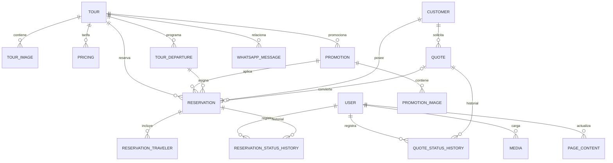

# Base de datos

## Tecnología y conexión

PostgreSQL se accede con Sequelize 6. `DATABASE_URL` tiene prioridad; en su ausencia se usan variables `PG*`. Producción activa SSL salvo `DB_SSL=false` y configura pool `{max:10,min:0,acquire:30000,idle:10000}`. Referencias: `src/database/index.js`, `src/config/database.js`.

Para Supabase desde una red sólo IPv4 debe usarse el **Session pooler**; la URL directa suele resolver a IPv6. No se deben versionar URLs reales.

## Entidades verificadas

Todos los IDs son UUID. Salvo historiales, las tablas usan `created_at` y `updated_at`.

| Tabla/modelo | Campos principales | Restricciones/índices destacados |
| --- | --- | --- |
| `users` / `User` | name, email, password, role, isActive, lastLogin | email único; roles `admin/editor`. |
| `tours` / `Tour` | name, slug, description, duration, price, JSONs, image, active/order, SEO | slug único; índices active/order. |
| `tour_images` | tourId, imageUrl, publicId, alt, order, primary | FK cascade; índice tour. |
| `pricings` | tourId, season, price/discount, vigencia, personas, active | FK cascade; índices tour/season/vigencia. |
| `tour_departures` | tourId, fechas, capacity, availableSpots, priceOverride, status | FK cascade; índice tour/fecha/status. |
| `promotions` | tourId, slug, descripción, vigencia, precio, JSONs, imagen, active/featured | slug único; FK tour set null; índices vigencia/destacada. |
| `promotion_images` | promotionId, imagen, alt, order, primary | FK cascade; índice promotion. |
| `customers` | nombre, email, phone, active | índices email y phone; no únicos. |
| `quotes` | code, customerId, contacto, destino, fechas, viajeros, presupuesto, status | code único; FK customer set null; índices status/fecha, customer, email. |
| `quote_status_history` | quoteId, from/to, note, changedBy | FKs quote cascade y user set null; índice cronológico. |
| `reservations` | code, quote/customer/tour/promotion/departure, contacto, fechas, viajeros, status | code y quoteId únicos; FKs set null; índices operativos. |
| `reservation_travelers` | reservationId, nombre, tipo, nacimiento, notas | FK cascade; tipo `adult/minor`. |
| `reservation_status_history` | reservationId, from/to, note, changedBy | FKs cascade/set null; índice cronológico. |
| `media` | nombres, MIME, size, path/url, dimensiones, alt/category, uploadedBy | FK user set null; índice category. |
| `page_contents` | page, section, key, value, type, metadata, active, updatedBy | combinación page/section/key única; FK user set null. |
| `settings` | key, value, type, group, description | key única. |
| `whatsapp_messages` | waMessageId, from/to, body/type/media, direction/status, tourId, read | waMessageId único; FK tour set null; índices from/direction/read/created. |

## Relaciones

Las cardinalidades reflejan asociaciones y constraints: varias FKs son opcionales y `SET NULL`.

## Migraciones

| Secuencia | Cambio |
| --- | --- |
| `20240101000001` | Usuarios. |
| `20240101000002` | Tours. |
| `20240101000003` | Imágenes y precios. |
| `20240101000004` | Media, contenido, WhatsApp y ajustes. |
| `20240101000005` | Índices iniciales. |
| `20261026000001` | FKs defensivas e índices compuestos. |
| `20261026000002` | Núcleo comercial: clientes, promociones, salidas, cotizaciones, reservaciones e historiales. |
| `20261111000001` | IDs públicos de Cloudinary. |
| `20261112000001` | Folios de cotización y backfill. |
| `20261112000002/3` | RLS y revocación de Data API, incluida `SequelizeMeta`. |

No deben editarse migraciones aplicadas. Para cambios nuevos, generar una migración posterior y mantener modelo, relaciones, validaciones y documentación coordinados.

## Integridad y transacciones

- Constraints únicas: emails de usuario, slugs, IDs WhatsApp, claves de ajuste/contenido, folios y una reservación por cotización.
- FKs aplican `CASCADE` para componentes dependientes y `SET NULL` para referencias históricas opcionales.
- Cotizaciones y reservaciones crean historial en la misma transacción.
- Confirmar/cancelar reservación bloquea la fila de salida.
- La actualización de lista de viajeros reemplaza todos los registros dentro de una transacción.

## RLS y acceso Supabase

Las migraciones habilitan Row Level Security y revocan privilegios a `anon` y `authenticated`. No se crean policies públicas: los clientes Supabase no deben acceder directamente a estas tablas. Toda operación de negocio debe pasar por la API Express.

`npm run audit:db-security` lista tablas sin RLS y grants indebidos; devuelve exit code distinto de cero al hallar alguno.

## Seed

El seed crea un `admin` y ajustes iniciales usando `INITIAL_ADMIN_*`. No es idempotente: repetirlo puede colisionar con email o keys. Debe ejecutarse una sola vez y retirar `INITIAL_ADMIN_PASSWORD` del entorno después.

## Procedimientos y respaldos

No se identificaron stored procedures, triggers de negocio, vistas ni estrategia de backup en el repositorio. Los respaldos dependen del proveedor PostgreSQL: **Pendiente de validación operativa**.

